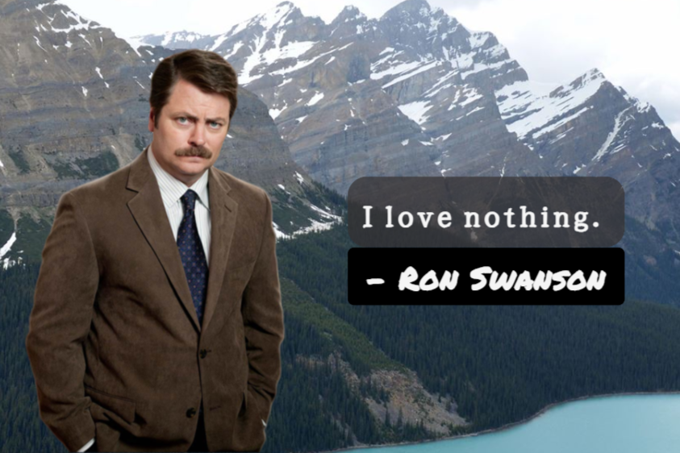

# Ron Swanson Quote Generator

A React application that fetches and displays random Ron Swanson quotes from Parks and Recreation.  
Users can generate new quotes and save their favorites as PNG images using HTML2Canvas.



---

## Project Status

`In Progress` — Core functionality complete. Image export size customization in development.

---

## Project Overview

This project explores client-side image generation by combining a public REST API with HTML2Canvas to capture and export UI elements as downloadable images.  
Built as a lightweight React exercise focused on API integration and browser-based image export.

---

## Features & Functionality

- Fetches random Ron Swanson quotes from a public API on demand
- Renders each quote as a styled card
- Exports the current quote card as a PNG image using HTML2Canvas
- One-click save — no server required for image generation

---

## Tech Stack

**Frontend**
- React
- JavaScript
- CSS

**Libraries**
- [HTML2Canvas](https://html2canvas.hertzen.com) — client-side DOM-to-image capture

**Data**
- [Ron Swanson Quotes API](https://github.com/jamesseanwright/ron-swanson-quotes) by James Wright

---

## Engineering Notes

**Client-side image export with HTML2Canvas**  
Rather than generating images server-side, HTML2Canvas captures the rendered DOM element directly in the browser and converts it to a PNG for download. This keeps the implementation entirely client-side with no backend dependency.

---

## Setup Instructions

**Clone the repository**
```bash
git clone https://github.com/diazelena325/ronswanson_qg.git
cd ronswanson_qg
```

**Install dependencies**
```bash
npm install
```

**Start development server**
```bash
npm start
```

Open your browser at `http://localhost:3000`

---

## Usage

1. Click **Generate New Quote** to fetch a random Ron Swanson quote
2. Click **Save Quote** to download the current quote card as a PNG image
